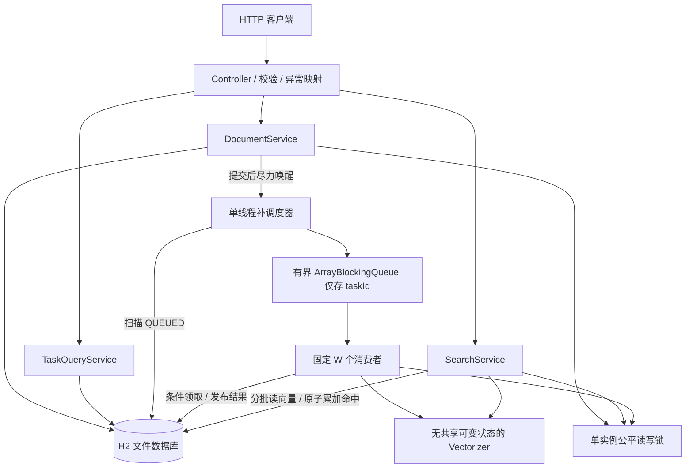
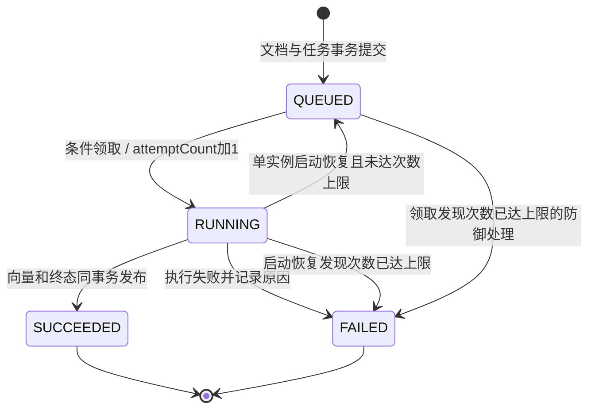

# 单实例文本向量化与检索服务设计

状态：整体方案已获审核，已按本轮六项意见修订；本文描述目标设计，不表示后续业务已实现。需求依据与默认规则编号见 [requirements.md](requirements.md)，实施与验证见 [plan.md](plan.md)。以下 SQL、流程和算法描述属于设计说明；本轮只将工程和持久化部分落地为 P1，其他部分留待后续。

## 1. 目标、边界与总体架构

目标是让异步入库、检索、失效和统计的正确性可解释、可验证。采用 Java 17、Spring Boot、Maven、Spring Data JPA、H2 嵌入式文件数据库。单 JVM、单实例独占数据库目录；不使用 H2 Server/AUTO_SERVER，不在多个服务实例间共享数据库文件。



职责拆分建议：

| 层/组件 | 负责 | 不负责 |
| --- | --- | --- |
| api | DTO、严格校验、HTTP 映射、requestId | 执行向量化、直接更新实体 |
| DocumentService | 提交、详情/列表、失效 | 管理 worker 线程 |
| TaskQueryService | 一致读取任务与文档视图 | 修改任务状态 |
| Dispatcher / WorkerPool | 调度去重、领取、执行与生命周期 | 将内存队列视为持久化任务账本 |
| Vectorizer / VectorCodec | 确定性特征、CPU 模拟、向量编解码与校验 | 访问数据库、计数、修改失效状态 |
| Similarity / TopKSelector | 分数、全序比较、堆选择 | 查询和过滤数据库 |
| SearchService | 候选过滤、批读取、结果计数与组装 | 持有共享向量缓存 |
| persistence | Repository、明确的部分字段更新、事务操作 | 向业务泄漏托管实体或懒加载对象 |

Spring Boot 的具体补丁版在实现阶段选定支持 Java 17 的稳定版本并锁定 Maven 依赖；本轮不宣称已验证某个版本。关闭 Open Session in View，DTO 在事务内完成投影，线程间只传 taskId 或不可变值对象。基础工具包按需使用，首版算法无需额外依赖。

## 2. 核心不变量

1. 文档 ID 全局唯一；一篇文档只有一个向量化任务，不覆盖、不更新原文、不复用失效/失败 ID。
2. 文档与 QUEUED 任务在同一事务中创建，不能只成功一半。
3. `vectorReady=true` 当且仅当对应任务 SUCCEEDED；发布向量、完成时间与任务成功状态必须同事务提交。
4. `invalidated` 与任务状态正交；只允许 false→true，发布向量绝不写此字段。
5. 检索候选条件是 `vector_ready=true AND invalidated=false`，再加可选渠道；未完成/失败都不参与。
6. 数据库是状态真相；队列和内存去重集合都允许重建，重复入队不能导致重复领取成功。
7. 命中数只由最终 Top-K 的原子增量更新；一个请求所有结果一起提交或一起回滚。
8. 同一算法版本对同一原文生成完全相同的 1,024 字节向量；不依赖任务 ID、渠道、时间、随机数、默认字符集。

## 3. 数据模型与索引

### 3.1 document_record

| 字段 | H2 设计类型 | 非空/默认 | 含义 |
| --- | --- | --- | --- |
| document_id | VARCHAR(64) | PK | 用户传入 ID，ASCII、大小写敏感（本项目约定，非题目要求） |
| original_text | CLOB | NOT NULL | 完整原文；空字符串允许，应用限制长度 |
| channel | VARCHAR(64) | NOT NULL DEFAULT 'default' | 渠道，允许中文，1–64 个 UTF-16 单元，大小写敏感 |
| submitted_at | TIMESTAMP WITH TIME ZONE | NOT NULL | 接收事务内生成的 UTC 提交时间 |
| vector_completed_at | TIMESTAMP WITH TIME ZONE | nullable | 成功完成时间；失败/未完成为 null |
| vector_ready | BOOLEAN | NOT NULL DEFAULT FALSE | 成功发布才置 true |
| invalidated | BOOLEAN | NOT NULL DEFAULT FALSE | 逻辑失效标记 |
| invalidated_at | TIMESTAMP WITH TIME ZONE | nullable | 首次失效时间 |
| hit_count | BIGINT | NOT NULL DEFAULT 0 | 服务端成功检索事务中的最终结果命中次数 |
| vector_bytes | VARBINARY(1024) | nullable | 256 个 float 的固定大端编码 |
| vector_version | VARCHAR(32) | nullable | 首版字符哈希算法标识 charhash-v1 |

不存重复的向量范数：扫描时用 double 计算，减少冗余一致性。默认不在实体查询中携带 CLOB 和向量，使用明确字段 DTO 投影；JPA 基本字段 LAZY 不作为“肯定不会加载”的保证。

### 3.2 vector_task

| 字段 | H2 设计类型 | 非空/默认 | 含义 |
| --- | --- | --- | --- |
| task_id | UUID | PK | 服务端生成 UUID |
| document_id | VARCHAR(64) | NOT NULL UNIQUE FK | 关联文档，一对一；禁止级联物理删除 |
| status | VARCHAR(16) | NOT NULL | QUEUED / RUNNING / SUCCEEDED / FAILED |
| created_at | TIMESTAMP WITH TIME ZONE | NOT NULL | 与文档 submittedAt 使用同一时间值 |
| started_at | TIMESTAMP WITH TIME ZONE | nullable | 最近一次成功领取的开始时间 |
| finished_at | TIMESTAMP WITH TIME ZONE | nullable | SUCCEEDED/FAILED 的终态时间 |
| attempt_count | INTEGER | NOT NULL DEFAULT 0 | 实际成功领取次数；最大 3，含初次及被中断的执行，不含数据库事务重试 |
| recovery_count | INTEGER | NOT NULL DEFAULT 0 | 启动时 RUNNING→QUEUED 恢复次数 |
| last_recovered_at | TIMESTAMP WITH TIME ZONE | nullable | 最近恢复时间，供解释中断 |
| error_code | VARCHAR(64) | nullable | FAILED 的安全业务错误码 |
| error_message | VARCHAR(1000) | nullable | 脱敏、截断的失败原因；完整堆栈只在本地日志 |

任务完成与文档完成时间：成功时 `finished_at=vector_completed_at`；失败时只有任务 finished_at，文档 vector_completed_at 保持 null。恢复成 QUEUED 时清空 started_at/finished_at/终态错误，保留计数和恢复时间；started_at 不是完整历史，本首版没有任务事件表。

### 3.3 DDL 草案（后续落地为 src/main/resources/schema.sql）

```sql
CREATE TABLE IF NOT EXISTS document_record (
    document_id VARCHAR(64) PRIMARY KEY,
    original_text CLOB NOT NULL,
    channel VARCHAR(64) NOT NULL DEFAULT 'default',
    submitted_at TIMESTAMP WITH TIME ZONE NOT NULL,
    vector_completed_at TIMESTAMP WITH TIME ZONE,
    vector_ready BOOLEAN NOT NULL DEFAULT FALSE,
    invalidated BOOLEAN NOT NULL DEFAULT FALSE,
    invalidated_at TIMESTAMP WITH TIME ZONE,
    hit_count BIGINT NOT NULL DEFAULT 0 CHECK (hit_count >= 0),
    vector_bytes VARBINARY(1024),
    vector_version VARCHAR(32),
    CONSTRAINT ck_document_vector CHECK (
        (vector_ready = FALSE AND vector_bytes IS NULL
            AND vector_version IS NULL AND vector_completed_at IS NULL)
        OR
        (vector_ready = TRUE AND vector_bytes IS NOT NULL
            AND OCTET_LENGTH(vector_bytes) = 1024
            AND vector_version IS NOT NULL AND vector_completed_at IS NOT NULL)
    ),
    CONSTRAINT ck_document_invalidated CHECK (
        (invalidated = FALSE AND invalidated_at IS NULL)
        OR (invalidated = TRUE AND invalidated_at IS NOT NULL)
    )
);

CREATE TABLE IF NOT EXISTS vector_task (
    task_id UUID PRIMARY KEY,
    document_id VARCHAR(64) NOT NULL UNIQUE,
    status VARCHAR(16) NOT NULL,
    created_at TIMESTAMP WITH TIME ZONE NOT NULL,
    started_at TIMESTAMP WITH TIME ZONE,
    finished_at TIMESTAMP WITH TIME ZONE,
    attempt_count INTEGER NOT NULL DEFAULT 0 CHECK (attempt_count >= 0),
    recovery_count INTEGER NOT NULL DEFAULT 0 CHECK (recovery_count >= 0),
    last_recovered_at TIMESTAMP WITH TIME ZONE,
    error_code VARCHAR(64),
    error_message VARCHAR(1000),
    CONSTRAINT fk_task_document FOREIGN KEY (document_id)
        REFERENCES document_record(document_id),
    CONSTRAINT ck_task_status CHECK
        (status IN ('QUEUED', 'RUNNING', 'SUCCEEDED', 'FAILED')),
    CONSTRAINT ck_task_terminal CHECK (
        (status IN ('QUEUED', 'RUNNING') AND finished_at IS NULL
            AND error_code IS NULL AND error_message IS NULL)
        OR (status = 'SUCCEEDED' AND finished_at IS NOT NULL
            AND error_code IS NULL AND error_message IS NULL)
        OR (status = 'FAILED' AND finished_at IS NOT NULL
            AND error_code IS NOT NULL AND error_message IS NOT NULL)
    )
);

CREATE INDEX IF NOT EXISTS idx_task_dispatch
    ON vector_task(status, created_at, task_id);
CREATE INDEX IF NOT EXISTS idx_document_search
    ON document_record(vector_ready, invalidated, document_id);
CREATE INDEX IF NOT EXISTS idx_document_channel_search
    ON document_record(channel, vector_ready, invalidated, document_id);
CREATE INDEX IF NOT EXISTS idx_document_submitted
    ON document_record(submitted_at DESC, document_id);
```

PK 和 UNIQUE 已提供唯一索引，不重复创建。两个检索索引分别覆盖不带渠道与带渠道的过滤/游标顺序；不对 CLOB 或向量内容建普通索引。列表可组合过滤，不为每种组合建索引。索引是否实际使用后续通过 H2 执行计划检查；不承诺低选择性布尔索引一定加速。

跨表“任务成功 iff 文档就绪”无法靠普通 CHECK 完整表达，依靠同一事务和集成测试。错误数值和长度由应用校验，DDL 提供兜底；保留额外约束的成本需在实现时验证 H2/JPA 类型兼容性。DDL 此时尚未执行验证。

### 3.4 启动建表与文件持久化

- 数据源使用类似 `jdbc:h2:file:./data/vector-search;DB_CLOSE_ON_EXIT=FALSE;WRITE_DELAY=0`，实际路径可配置；从明确的工作目录运行，防止换目录误以为数据丢失。WRITE_DELAY=0 用于减少写延迟窗口，不能替代磁盘可靠性或备份。
- `spring.sql.init.mode=always` 执行随包提供的 schema.sql；`spring.jpa.hibernate.ddl-auto=validate` 只校验映射，不用 create/create-drop/update 偷换 DDL。初始化顺序必须在 JPA 校验之前，以真实启动测试确认。
- IF NOT EXISTS 只保证重复启动建表无损，不是 schema 迁移机制。结构改变时另提供显式迁移说明和脚本，不能指望旧表自动改变。
- 数据目录、日志、target 和 IDE 临时文件后续加入 .gitignore；数据库文件不提交到 Git，不放入交付包。当前阶段落地 P1 工程和持久化，不包含调度或检索实现。

## 4. 状态机



内存入队/出队不是状态：排队中既包含“持久化等待调度”，也包含“已入内存队列”。失效不新增任务状态，任何任务状态下都能标记文档失效。首版没有取消、人工重试、回滚成功或复活失效文档的 API。

正常执行失败直接终止；只有进程中断后遗留 RUNNING 才恢复。3 次上限包含初次执行和每次被中断的执行；提交未确认的领取先核对数据库，不能盲目再加 attemptCount。数据库事务有限重试不等于重新计算向量。attemptCount=3 且进程再次中断，重启标记 FAILED/RECOVERY_LIMIT_EXCEEDED；已经 SUCCEEDED 的任务无论 attemptCount 是多少都保持成功。

## 5. 主要流程和事务边界

### 5.1 文档提交

1. 校验 JSON、ID、文本和渠道；在任何数据库写入和排队之前拒绝非法参数。
2. 获取公平读写锁的写锁（超时默认 2 秒），再开启短事务 T1。
3. 查询 ID 已存在则 409；再统计 QUEUED+RUNNING，达到 maxPendingTasks 则 503。所有提交共用写锁，避免并发检查导致超收；任务完成/失败只会减少积压，不影响上限安全。
4. 使用同一 submittedAt 插入文档、QUEUED 任务，提交事务；主键冲突仍必须映射 409，不能只靠事先查询。
5. 释放写锁。仅做非阻塞的调度唤醒，返回 202。提交后唤醒异常不得把已接收请求改成 500，周期扫描负责补偿。

CPU 向量化绝不在 HTTP 提交线程中执行；不使用 CallerRunsPolicy。提交需要等待必要的校验、锁和数据库事务，异步不表示“完全没有阻塞”。客户端丢失响应可用自己的 documentId 查任务，不可据此假定未入库。

### 5.2 补调度、领取与执行

**队列组织**：ArrayBlockingQueue<UUID>，容量默认 1,000；W=2 个命名消费者线程长期执行 take→处理循环。可用固定大小执行器承载这 W 个长期循环，但不把每个业务任务 submit 到另一个无界队列，也不再用 @Async 增加隐式队列。

**调度器**：一个周期线程，默认每秒扫描；提交唤醒复用同一调度入口并合并唤醒信号，不能每次提交都在执行器里积压一个扫描任务。

1. 查询 status=QUEUED，按 created_at、task_id 升序分页，键集游标遍历；优先旧任务，但不承诺完成顺序。
2. 内存 HashSet scheduledIds 同时覆盖队列中和当前执行中的 ID。仅由封装组件持有，**所有访问（add、remove、contains、size、遍历、快照、clear）一律 synchronized 同一个私有 final monitor**；不混用无锁读、并发集合或另一把锁。锁内完成“add→queue.offer”，重复 ID 跳过，offer 失败/抛异常时移除本次新增 ID。offer 非阻塞；锁内绝不访问数据库、做 CPU 计算、睡眠、等待 queue.take 或获取全局读写锁。
3. 被去重跳过的行也推进游标，不能反复只读第一页而饿死后面的未调度任务；下周期从头开始。内存集合规模不超过容量+W，不存文本或向量。
4. worker 取出 ID 后，短事务 T2 执行条件更新：只有 QUEUED 且 attempt_count<3 才改 RUNNING、attempt_count+1、started_at=当前时间；影响行数=1 才能执行。读取本次 attemptCount 和原文后提交，持久化状态先于计算。
5. worker 在数据库事务和全局读写锁之外执行 CPU 工作，生成局部向量和编码。每个任务单独捕获普通执行异常，防止一个坏任务杀死整个消费者循环。
6. 成功后获取写锁，开启 T3：使用 status=RUNNING 且 attempt_count=本次领取次数的条件把任务改 SUCCEEDED；条件不匹配则不发布。更新文档的向量、版本、就绪和完成时间，影响行数必须为 1；一起提交后释放锁。
7. 失败在短事务 T4 中使用同样的任务状态/次数条件标 FAILED 并保存安全原因；文档保持未就绪。正常失败没有下一次自动计算。
8. worker 在 monitor 外执行 queue.take，**出队不删集合**；领取、计算、发布以及数据库异常核对完成后，在 finally 中 synchronized 同一 monitor 删除 ID。领取已被别人完成/条件不匹配也走此 finally。日志/指标只在锁内复制 size 或不可变快照，遍历/输出在锁外；只在 worker 和调度器全部停止且 join 完成后，才可在同一 monitor 内清空集合和队列。未完成停止时禁止 clear，避免旧 worker 与新调度交错。若取出后立即开始，仍需经过 monitor 的后续访问协议；queue 自身线程安全保证取放，集合生命周期由 monitor 保证。若入队后延迟、进程退出或投递失败，DB 中 QUEUED 仍能被扫描发现。

条件领取是最终防线，内存集合只是减少重复投递；不宣称“消息恰好一次”。同一文本可能因进程恢复重新计算，计算应无外部副作用。

### 5.3 同步检索

1. 校验 text/topK/channel；尝试获取有界检索许可（默认最多 4 个并发检索，非阻塞失败返回 503 SEARCH_BUSY），避免同步 CPU 和扫描淹没服务。
2. 在锁和事务外，使用与入库一致的向量化管线生成查询向量；业务校验错误不重试。
3. 获取读锁（默认最多等待 2 秒）。在持锁期间，提交、失效和成功发布的写锁均不能修改候选资格。
4. 按 document_id 升序键集分页读取符合条件的候选，每批默认 256 条，只投影 ID 和 vector_bytes/vector_version；每批使用独立短只读事务，结果复制到局部值，不保留 EntityManager。逐条校验/解码/计算并更新 Top-K 堆；没有全库向量缓存。
5. 分批读结束后，对堆按最终顺序排序。空结果直接返回，不开启计数写事务。
6. 在仍持读锁时，开启 T5，对最终结果 ID **统一按 document_id 升序**执行原子 `hit_count=hit_count+1`，然后读取这些文档详情并组装不可变结果对象；计数全部成功才提交。事务内更新可同时带就绪/有效谓词并校验影响行数，应全部为 1，否则视为不变量错误回滚。
7. 使用嵌套 try/finally：只有实际获取许可才 release，只有实际持读锁才 unlock；任何返回、超时、取消、解码异常、数据库异常都先完成回滚/提交资源清理再释放锁和许可。提交成功返回 200；不要逐文档提交，也不要先返回再异步计数。

持读锁跨越批次读取和计数事务，稳定的是“候选成员及其不可变向量”，不要求长数据库快照。其他检索仍可并发进行；它们的计数写入会通过数据库行锁串行。列表/任务查询可在此期间读取状态。全文只为最终 K 条加载，避免每个候选都读 CLOB。

**整体预算与取消（P4 实现）**：进入 SearchService 即用 System.nanoTime 建立默认 10 秒绝对截止时间，覆盖查询向量化、锁等待、扫描、数据库重试和计数事务。锁等待取 min(2 秒, 剩余预算)，不能每次重试重置总预算。CPU 模拟每批轮次、特征循环每 256 项、每批候选前后和每 64 次算分、每条命中更新前、事务提交前检查截止时间与线程中断。取消令牌同时接受应用关闭信号；保留中断标记。客户端断开在同步 Servlet 中不保证即时感知，不能以“客户端取消了”作为唯一检查来源。

数据库连接获取、语句、事务和行锁等待均设置有限超时，并按剩余预算缩短；若驱动只能秒级配置且剩余不足 1 秒，则不启动新的数据库操作。不在锁内做重试退避：已确认回滚后释放读锁，退避并重新取得读锁后重新扫描，候选可能改变；最终只给新结果计数。计数未提交的超时/取消回滚，返回 503 SEARCH_TIMEOUT/SEARCH_CANCELLED；**提交已成功才发现截止或断连，不能撤销计数或谎称已回滚**，按已提交结果处理；提交不明走 §6.4。总预算是协作式截止，不承诺 JDBC 提交或网络传输能在精确 10 秒被强杀；测试应证明受支持的超时/中断路径最终释放资源，不留下无限持锁线程。

### 5.4 标记失效

获取写锁→开启 T6→检查文档存在→若尚未失效，仅更新 invalidated=true、invalidated_at=首次时间→读取摘要→提交→释放写锁。已失效直接返回现状，不改时间、不重置计数、不改任务。

发布向量时只更新向量相关列，禁止把先前读取的完整 Document 实体 merge/save 回去。这既避免覆盖失效标记，也避免覆盖并发 hit_count。任务已失败或还在排队也可失效。

### 5.5 统计和文档查询

统计以文档字段展示，列表与详情直接读取 hit_count、channel、submitted_at、vector_completed_at。任务和文档视图用单次关联查询读取，不在多个独立查询之间拼出“任务成功但文档未就绪”的瞬间视图。

列表内容与 totalElements 需要一致时，放在一个短的 REPEATABLE_READ 只读事务中；此隔离级别必须在 H2 集成测试验证。跨页多次请求不是同一快照，新文档或任务变化可能引起分页移动；首版不承诺分页会话一致性。

没有额外全局统计接口，也没有检索请求明细表。计数表示服务端事务成功的次数：计数提交后连接断开，计数不会撤销；客户端重试会再计一次，不能承诺网络意义上的 exactly-once。

### 5.6 事务与锁一览

| 事务 | 内容 | 全局锁 | 锁外工作 |
| --- | --- | --- | --- |
| T1 | 文档+任务插入、积压检查 | 写锁，覆盖提交 | 入参解析、调度唤醒 |
| T2 | QUEUED→RUNNING 条件领取、读取原文 | 无 | CPU 向量化 |
| T3 | 任务成功+文档向量发布 | 写锁，覆盖提交 | 向量计算/编码 |
| T4 | 任务失败与原因 | 无，不改变候选资格 | 异常归类/日志 |
| T5 | 最终 K 条命中自增、详情读取 | 读锁，覆盖提交 | 查询向量生成 |
| T6 | 逻辑失效 | 写锁，覆盖提交 | 参数校验 |
| T7 | 启动时恢复未完成任务 | HTTP/worker 未就绪 | 队列重新构建 |

默认数据库事务使用 READ_COMMITTED；列表总数/内容一致性按上文单独设置。通过 TransactionTemplate 或独立代理 Bean 明确边界，避免同类自调用使 @Transactional 失效。

**统一顺序**：全局锁（需要时）→数据库事务→必要的行锁→提交/回滚→释放全局锁。T2/T4 必须先完成事务再尝试其他锁，绝不持数据库锁等待全局锁。多个文档的计数更新统一升序，降低并发搜索间的死锁风险；仍处理数据库超时并整体回滚。

## 6. 线程安全、过载与故障处理

### 6.1 线程安全策略及取舍

- 公平 ReentrantReadWriteLock 作为唯一候选可见性锁：检索持读锁；提交、失效、成功发布持写锁。公平性避免持续读流量让失效长期饿死。
- 检索会阻塞后续失效/发布，耗时与库大小有关。小型面试项目采用易证明的顺序；性能不足时才考虑快照版本和二次验证，首版不引入这些复杂度。
- HTTP 写锁/检索读锁获取超时返回 503；worker 发布使用可中断等待，避免因短暂检索竞争把正确任务标成业务失败。数据库操作配置有限超时。
- 所有数据库更新使用部分列或条件 SQL；不跨线程共享 JPA 实体、不做读改写 hit_count、不共享可变 float[]。此方案不依赖 @Version；如未来引入实体全量更新，必须重新评估并发协议。
- 向量器、相似度器无可变共享状态；MessageDigest、ByteBuffer、数组、堆均为请求或任务局部对象。队列和去重集合的访问封装，不能各处自行更改。
- 使用独立执行上下文：HTTP 请求线程、W 个工作线程、1 个调度线程。禁止无界创建线程或按任务创建新执行器。

### 6.2 有界资源和初始参数

| 参数 | 建议初值 | 作用 |
| --- | --- | --- |
| workerCount | 2 | 后台 CPU 并行度；按实际机器测量调整 |
| queueCapacity | 1,000 | 内存调度槽，不等于可接收任务总数 |
| maxPendingTasks | 10,000 | QUEUED+RUNNING 的数据库积压接收上限 |
| dispatchInterval | 1 秒 | 补投延迟尺度，不是任务完成 SLA |
| maxAttempts | 3 | 包含初次及被中断的执行，与数据库操作重试独立 |
| maxDbAttempts | 3 | 已确认整体回滚的临时错误：首次 + 2 次事务重试 |
| searchBudget | 10 秒 | 整体协作式预算，不等于只限制锁等待 |
| candidateBatchSize | 256 | 单次候选读取和解码内存边界 |
| maxConcurrentSearches | 4 | 搜索 CPU/扫描并发上限 |
| httpGateWait | 2 秒 | 全局锁等待上限，不是整个检索超时 |
| shutdownGrace | 30 秒 | 优雅停机等待窗口 |
| simulationRounds | 20,000 | 固定 CPU 工作量初值；以实测校准，不宣称固定毫秒 |

积压阈值检查在提交写锁下串行，避免两个提交同时看到空闲额度。容量满不把任务直接标 FAILED，因为仍可后续执行。磁盘无空间/数据库不可写时不能返回接收成功。

该阈值只限制未完成任务，终态文档仍持续占用磁盘；没有自动清理策略。原文最大 20,000 个 UTF-16 单元，10,000 个积压任务仍可能占显著磁盘空间，必须按演示数据规模使用和观察。

### 6.3 重启恢复与漏调度

启动顺序：建表→JPA 校验→确认文件独占→T7 恢复→启动 worker/调度器→对外 ready。恢复之前业务接口返回 503 SERVICE_NOT_READY，不允许旧状态与新工作线程交叉执行。

- QUEUED：保持状态，周期扫描重新入队。
- RUNNING 且 attemptCount<3：转 QUEUED，recoveryCount+1，记录 lastRecoveredAt，清空当次 startedAt/终态字段；下一次领取再增加 attemptCount。
- RUNNING 且 attemptCount>=3：改 FAILED，写 RECOVERY_LIMIT_EXCEEDED 和 finishedAt。
- SUCCEEDED/FAILED：保持原样，绝不因“队列是空的”重新执行终态任务。
- 恢复操作在新 worker 启动之前完成，内存队列和去重集合从空重建。多条记录可在同一恢复事务处理；若规模超过本设计上限再做分批。

| 中断位置 | 落库状态 | 重启行为 |
| --- | --- | --- |
| T1 提交前 | 两条都没有，或事务回滚 | 客户端可重新提交 |
| T1 已提交、未唤醒/未入队 | QUEUED | 补扫投递，不丢任务 |
| 已入队、未领取 | QUEUED | 队列丢失无影响 |
| T2 已提交、CPU 或发布前 | RUNNING | 有界恢复，可能重复计算 |
| T3 执行中但未提交 | 整个事务回滚为 RUNNING/未就绪 | 有界恢复，不留下半成品 |
| T3 已提交、清理集合前 | SUCCEEDED/就绪 | 不重复计算；旧内存自然丢弃 |
| T5 已提交、HTTP 响应丢失 | 计数已增加 | 保留计数；客户端重试会再次计数 |

### 6.4 数据库故障、执行错误和停机

入参错误在提交前拒绝；实际算法/文本数据错误写 FAILED，不自动重试。提交/查询数据库不可用返回 503；失败事务不保留部分记录或部分计数。

数据库异常按**事务最终结果 + 根因**分类，不能仅看到 DataAccessException 就退出进程；Hibernate/JDBC 将事务标 rollback-only 还不等于已经确认回滚，需要事务管理器完成回滚或新连接核对。数据库操作重试计数仅在当前调用内维护，不修改任务 attemptCount/recoveryCount，不重新调用 Vectorizer。

| 类别 | 判断和处理 | 服务级影响 |
| --- | --- | --- |
| 业务/约束错误 | 已知文档 ID 唯一冲突映射 409；其他 FK/CHECK/映射错误视为数据/程序错误，不自动重试；不要把所有完整性错误都当重复 ID | 单请求失败并记录原因，通常不退出 |
| 已确认整个事务回滚的临时冲突 | 如经确认回滚的死锁/锁超时，最多 3 次数据库事务尝试（首次+2 次），退避 50/100 ms，受操作预算约束；每次新事务，释放数据库资源和全局锁后再退避 | 重试耗尽：HTTP 503；领取失败且确认为 QUEUED 可由补扫重新调度，不增加执行次数 |
| 持续不可用 | 连接获取/I/O 故障等在有限尝试后仍失败；提交阶段故障还要归入下一行的不确定结果 | not-ready，拒收/暂停调度与新领取，保持进程存活；每 5 秒只做一次轻量连接及 SELECT 1 探测，最多 12 次。成功后先核对在途任务再恢复；耗尽则保持降级等待人工重启，不能后台无限重试业务写入 |
| 提交结果不明确 | commit/连接异常无法确认回滚：不盲重放写操作；用新连接读取持久化状态。T1 按 documentId/taskId 核对，T2 按状态和本次预期 attemptCount，T3/T4 按终态及本次 attemptCount，T6 按失效标记核对 | 无法读取时进入上行降级；核对成功才恢复。若无法隔离并确定旧事务已结束，才受控关闭后按启动恢复处理 |

**在途 worker**：计算结果或错误原因可在该 worker 的局部变量中保留，数据库恢复后只重试发布/失败事务，不重算、不增加 attemptCount；每个 worker 最多保留一个结果，不形成共享缓存。发布/失败事务若因临时冲突耗尽而尚未终结，也进入暂停领取/核对的协调流程，不能简单 remove ID 后永远留下 RUNNING。恢复时由同一 worker 完成本次发布；若上下文已丢失、worker 已退出或需重算，则先受控关闭，再通过启动恢复消耗下一次执行机会。不在活着的旧 worker 尚可能写入时把 RUNNING 改回 QUEUED。

**T5 特例**：没有检索请求审计表时，单看累计 hit_count 不能判断某次增量是否提交。只有“确认整体回滚”才允许重新执行；提交不明返回 503 STORAGE_OUTCOME_UNKNOWN，不自动重放、不承诺计数未变化。确认连接/事务已结束后，其他请求可继续，单次计数不明本身无需整个服务退出；客户端通过 requestId 排查。此限制已在需求 D07/D15 公开。

P1 只建立异常响应和保守分类基础；有限重试、探测、worker 协调与恢复在 P3/P4 落地，不能在 P1 伪造已实现能力。单独的运行时异常类不能证明回滚已确认，分类依据和实际事务边界必须一起验证。

优雅关闭：先 not-ready、拒绝新业务请求→停止调度→允许现有 worker/检索在 30 秒内完成→超时中断并关闭执行器/数据源。CPU 模拟周期检查中断，停机中断不是业务 FAILED；未发布任务保持 RUNNING。队列中任务保持 QUEUED。突然 kill -9 没有优雅阶段，仍走恢复表。

不可恢复 JVM 错误不吞掉后继续运行；健康状态必须能暴露工作线程退出。简要日志包含任务状态变化、队列/积压量、恢复次数、失败代码，不记录完整文档文本；这属于可解释运行的配套能力。

## 7. 模拟向量、编码和检索算法

### 7.1 charhash-v1：可解释的词面相似性

输入保持原文，不 trim、不转小写、不做 Unicode 归一化。先校验 UTF-16 代理项合法，再按 Unicode code point 顺序遍历，避免把一个 emoji 拆成两个字符。空字符串产生长度 256 的全正零 float 数组。

对于非空文本：

1. 取所有单字符特征（unigram，权重 1）及相邻双字符特征（bigram，权重 2）。例如“Java”含 J/a/v/a 和 Ja/av/va，重复特征累计计数。
2. 每个特征按“1 字节类型标识 0x01/0x02 + 每个 code point 的 4 字节大端整数”编码。这种格式固定，避免拼接歧义、平台默认字符集和分隔符冲突。
3. 对特征编码求 SHA-256，取摘要首字节的无符号值（0–255）作为桶编号；int[256] 桶内累加对应权重。20,000 单元的长度上限保证总权重不超过 59,998，不会 int 溢出。
4. 按下标 0→255 用 double 累加平方和，StrictMath.sqrt 求 L2 范数；各桶先用 double 除以范数，再转 float。无特征时全零；固定顺序，无并行归约。

特征相同必落到相同桶；共享较多字符/相邻片段通常相似度较高。256 桶碰撞可能造成无关文本分数升高；语序只由局部 bigram 部分表达；大小写、繁简体和同义词不会自动等价。题目不要求真正语义近似，不能把此算法称作真实 Embedding 模型。

### 7.2 CPU 耗时模拟与确定性

纯向量算法为 Vectorizer 的可测试核心；另设 CpuWorkSimulator，用固定轮数反复对固定大小摘要做 SHA-256 计算，并消费其结果（例如返回校验值供管线验证），避免只有空循环或 sleep。循环定期检查中断。

文档 worker 和同步检索都调用同一管线“校验→CPU 模拟→纯向量算法”；CPU 模拟结果不改变向量，任务/查询输出完全一致。轮数是工程演示参数，测试可缩小，实际耗时由 CPU 决定。模拟 CPU 算法即使加大也不能阻塞文档提交 HTTP 线程。

确定性验收包括多次调用、并行调用、不同进程、应用重启后比较完整编码字节。算法版本一旦改变必须更换 version 并显式迁移；首版发现旧/未知版本则报错，不混算。

### 7.3 二进制存储格式

- 256 × 4 = 1,024 字节，IEEE 754 binary32，固定 BIG_ENDIAN，下标 0 在前。
- 向量保存为 VARBINARY(1024)，版本单独保存；不使用 Java 对象序列化，不将 float 转 JSON 字符串入库。
- 编码/解码校验长度=1,024、维数=256、所有值有限（无 NaN/Infinity）；charhash-v1 值应非负；全零合法。
- 已存向量不在解码时再次归一化，避免修改字节语义；余弦计算自身处理范数。数组只在当前请求/任务内使用，必要时防御性复制。
- 检索遇到损坏长度、非有限值或版本不一致，返回 VECTOR_DATA_INVALID，不默默跳过候选造成看似正确的 Top-K。

### 7.4 余弦相似度

对两个 256 维向量，按固定下标顺序用 double 累加点积和平方和：

`score = dot(q, v) / (sqrt(sum(q²)) * sqrt(sum(v²)))`。

任一范数为 0，则按 D06 定义 score=0。两个空文本的向量虽完全一致，分数仍为 0，不特别改成 1。例如有效就绪文档 A/B/C 的初始命中都为 0，空查询 topK=2 返回 A、B（分数 0），计数变为 1/1/0；失效和渠道过滤仍先执行。非零向量同文本分数约为 1；向量逐位相同要求不等于分数一定十进制精确 1。最终对浮点舍入做 [-1,1] 范围夹取，统一负零为正零，不在排序前四舍五入。

首版非负特征向量正常分数位于 [0,1]。返回 JSON number，展示可缩短小数但排序必须用完整 double 值。单测使用误差界验证余弦，确定性测试使用逐位比较验证向量，两者不要混淆。

### 7.5 精确 Top-K

过滤在数据库阶段完成：就绪、有效、可选渠道。每个候选算分后进入容量 K 的最小堆。

- 最终顺序：score 降序；同分 documentId ASCII 升序。
- 堆顶为“当前最差”：score 最小；同分 ID 最大。
- 堆未满直接加入；满时只有新候选按最终顺序优于堆顶才替换；候选 ID 唯一，不重复计数。
- 扫描结束仅对堆中至多 K 条按最终顺序排序；K>N 时返回 N，N=0 返回空；不设置相似度阈值。

令 N 为过滤后候选量、D=256、批大小 B=256：计算复杂度 O(N·D + N·log K + K·log K)，向量批和堆额外内存 O(B·D + K)，再加最终 K 篇原文的响应内存。没有 ANN 近似误差，但每次全量扫描，不能承诺海量数据低延迟。

通过“对所有合法候选算分后完整排序取前 K”作为测试参考实现，验证堆比较器尤其是同分分支，避免只检查结果条数。

## 8. 关键设计取舍与已知限制

| 选择 | 理由 | 代价/适用限制 |
| --- | --- | --- |
| 数据库任务账本 + 内存调度队列 | 入队失败可补偿，重启可恢复 | 需要扫描、条件领取和恢复策略；不是持久化 MQ |
| 单实例公平读写锁 | 清晰定义检索/失效/发布的先后顺序 | 大库检索阻塞写操作；不能跨 JVM 使用 |
| 原子部分列更新 | 防丢计数、防覆盖失效标记 | 需要明确 SQL 和事务影响行数检查 |
| 成功发布与任务终态同事务 | 防止“任务成功但向量不存在” | 数据库故障分级降级/核对，只有无法安全恢复才停机；首版没有高可用 |
| 二进制 float 存储 | 固定格式、无精度文本转换、容易逐字节验收 | 人工查看不直观，需测试解码器 |
| 字符特征哈希 + 余弦 | 少依赖、确定性、可解释 | 碰撞、弱语义、文本长度和重复特征影响结果 |
| 批扫描 + K 堆 | 精确、有限内存、体现数据结构 | 每次 O(N·256)，性能上限应实测 |
| 逻辑失效不取消计算 | 状态维度独立、竞争容易处理 | 无效文档也消耗计算和存储 |
| 执行异常不重试，中断才有界恢复 | 不掩盖逻辑错误，不无限循环 | 瞬时执行失败也需排查，新任务要用新 ID |
| 同步计数事务 | 返回集合与计数成功原子对应 | 热门文档计数会形成行锁竞争；网络交付不具备恰好一次语义 |

本设计适合单人面试演示、小型数据集、单进程文件库。尚无吞吐/延迟测量，不能写成“支持多少 QPS”。不覆盖分布式、物理清理、算法在线升级、公开服务安全、高可用和灾难恢复。系统时钟回拨可能影响时间戳排序，时间不是任务状态的判断依据。

## 9. 面试时应能解释的论证

1. 为什么不能“先入队再入库”？worker 可能读不到任务，且事务失败时产生幽灵任务。先落库再补扫缩小问题为可恢复的调度延迟。
2. 为什么去重集合不能代替条件更新？集合可能在重启丢失或投递竞争中失效，数据库条件更新才决定执行权。
3. 为什么成功状态和向量同事务？否则检索或任务查询可能观察到半成品，重启也无法可靠判断。
4. 为什么不使用读取计数后 save？并发会覆盖；更新向量时全量 save 还会覆盖已失效字段。
5. 为什么不承诺“失效之后绝无旧结果到达客户端”？已完成检索的网络响应无法撤回，只能定义服务端操作的线性化顺序。
6. 为什么浮点确定性要固定编码和归约顺序？默认字符集、随机种子和并行累加顺序都可能破坏逐位一致。
7. 为什么 H2 文件重启测试要真实进程和真实文件？内存库或同 JVM 重建 Bean 不能证明进程中断、文件持久化和启动恢复。
8. 为什么此项目仍可能重复计算？提交后进程中断使计算结果丢失，恢复需要重算；无副作用的确定性算法允许这样做。
